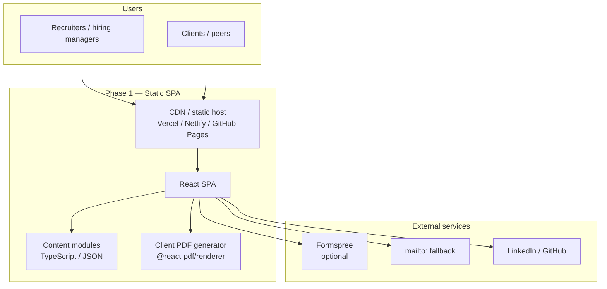
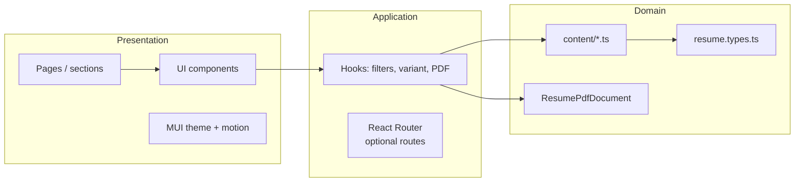
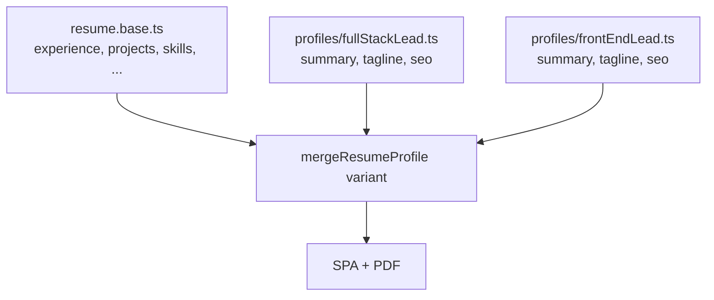
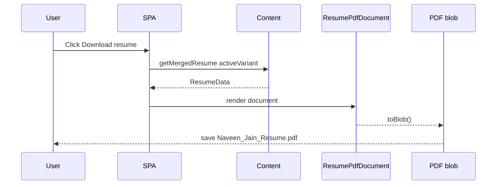
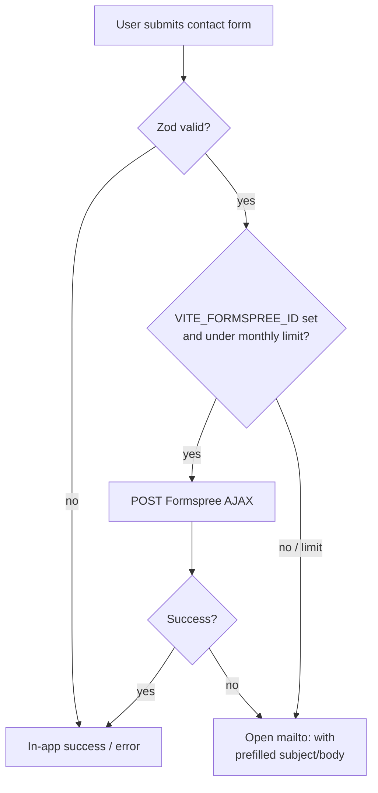

# System architecture

## 1. Vision

Build a **dynamic, highly interactive, professional** personal website that presents Naveen Jain’s resume and portfolio. **Phase 1** has **no custom backend**; all content is loaded from typed local modules. **Phase 2** may add APIs, CMS, or analytics without rewriting the UI if the data layer keeps stable TypeScript types.

## 2. Context diagram



## 3. Architectural principles

1. **Single source of truth** — One content model drives the marketing UI and downloadable PDF.
2. **Config over duplication** — Profile variants (`fullStackLead`, `frontEndLead`) are data merges, not separate page trees.
3. **Progressive enhancement** — Contact works via Formspree when configured; **mailto** always works as fallback.
4. **Phase-2 ready** — Replace `loadResumeContent()` implementation with `fetch('/api/resume')` using the same types.
5. **Accessibility & performance** — WCAG-minded components, Lighthouse-oriented bundles, `prefers-reduced-motion`.

## 4. Logical layers



## 5. Profile variants

| Variant ID | Default? | Positioning (tagline emphasis) |
|------------|----------|--------------------------------|
| `fullStackLead` | **Yes (first load)** | Technical Lead · Full-Stack Architecture & Team Delivery |
| `frontEndLead` | No | Technical Lead · Front-End Architecture & Team Delivery |

**Activation:**

- Default: `fullStackLead` in config / env `VITE_DEFAULT_PROFILE=fullStackLead`
- Override: URL query `?profile=frontEndLead` (shareable links for FE-focused roles)
- Optional UI: subtle toggle in About or footer (product decision at implement time)



## 6. Site information architecture (Phase 1 — rich portfolio)

Primary UX: **single-page** with anchored sections (smooth scroll). Optional routes for deep links.

| Section ID | Purpose |
|------------|---------|
| `#hero` | Name, variant tagline, metrics, CTAs (contact, download PDF) |
| `#about` | Summary paragraphs |
| `#experience` | Timeline + expandable roles |
| `#projects` | Filterable grid + detail modal/drawer |
| `#skills` | Grouped chips; filters projects |
| `#achievements` | Awards & highlights |
| `#education` | Degrees |
| `#contact` | Form + social links |

Optional routes (later in build):

- `/projects/:slug` — shareable project detail
- `/resume/preview` — PDF layout preview

## 7. Dynamic PDF (no static resume PDF as source of truth)

Historical files under `Resumes/*.pdf` are **reference only**. The live site generates PDF from `content/`.



PDF layout is **simpler than the marketing site** (A4, print typography) but uses the **same fields** as the UI.

## 8. Contact architecture



Details: [CONTACT_AND_INTEGRATIONS.md](./CONTACT_AND_INTEGRATIONS.md)

## 9. Phase 2 (placeholder — not in scope)

| Capability | Direction |
|------------|-----------|
| CMS / admin | Headless CMS or custom API |
| Blog | MDX or CMS posts |
| Analytics | Plausible / GA with consent |
| Server PDF | CI or Puppeteer if client PDF insufficient |
| Auth | Only if needed for drafts |

Types in `DATA_MODEL.md` should remain the contract.

## 10. Planned repository layout (after scaffold)

```
NaveenResume/
├── document/                 # This documentation
├── Resumes/                  # Legacy HTML/PDF reference
├── public/                   # favicon, OG image, static assets
├── src/
│   ├── content/              # Source of truth
│   │   ├── resume.base.ts
│   │   └── profiles/
│   ├── types/
│   ├── components/
│   ├── sections/             # Hero, Experience, ...
│   ├── pdf/                  # ResumePdfDocument
│   ├── theme/
│   ├── hooks/
│   ├── App.tsx
│   └── main.tsx
├── .env.example
├── package.json
└── README.md
```

## 11. Non-functional requirements

| Area | Target |
|------|--------|
| Performance | Lighthouse mobile ≥ 90 where feasible |
| Accessibility | WCAG 2.1 AA patterns (MUI baseline + audits) |
| SEO | Title/description per variant; JSON-LD `Person` |
| Security | No secrets in git; env for Formspree |
| Browser support | Last 2 versions of major browsers |
| Motion | Respect `prefers-reduced-motion` |

## 12. Locked product decisions

| Topic | Decision |
|-------|----------|
| Contact email | `naveen.jain94@hotmail.com` |
| Contact phone | `+91-9999003538` |
| Default profile | `fullStackLead` |
| Phase 1 scope | Rich portfolio (filters, modals, timeline) |
| PDF | Dynamic from site content |
| Formspree | Use free tier; **mailto fallback** on missing ID, failure, or limit |

## 13. Related docs

- [REQUIREMENTS.md](./REQUIREMENTS.md)
- [TECHNOLOGY_STACK.md](./TECHNOLOGY_STACK.md)
- [DATA_MODEL.md](./DATA_MODEL.md)
- [AGENT_IMPLEMENTATION_CONTEXT.md](./AGENT_IMPLEMENTATION_CONTEXT.md)
