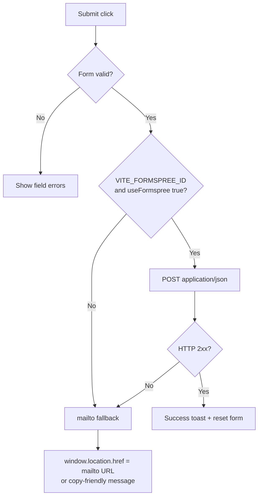

# Contact & integrations

## 1. Goals

- Allow visitors to send a message **without a custom backend** in Phase 1.
- Never block contact when Formspree is unavailable or over quota.
- Keep **mailto** as a permanent fallback.

## 2. Formspree overview

| Plan | Cost | Submissions / month |
|------|------|---------------------|
| Free | $0 | **50** |
| Personal | ~$15/mo | 200+ |

Free tier includes:

- Unlimited forms/projects
- AJAX submissions (React)
- Basic spam filtering
- ~30-day submission visibility in dashboard (submissions still emailed when configured)

Free tier limitations:

- No file uploads on free plan
- 50 submissions/month cap (notifications at 50/75/90/100% usage)
- Some features (custom thank-you redirect on non-AJAX, autoresponders) on paid tiers

Official reference: [formspree.io/plans](https://formspree.io/plans)

## 3. Recommended flow (implementation)

### mailto fallback details

- **To:** `naveen.jain94@hotmail.com`
- **Subject:** `Portfolio contact from {name}`
- **Body:** Include name, reply email, message (URL-encoded)
- UX: brief notice: “Opening your email client…” or show copyable text if `mailto` blocked (mobile)

### When to prefer mailto without trying Formspree

Implementer may add a runtime flag after repeated 429/limit errors (optional v1.1):

- LocalStorage key `contactPref=mailto` after one failed quota response
- Or env `VITE_FORCE_MAILTO=true` for maintenance

## 4. Form fields (minimum)

| Field | Validation |
|-------|------------|
| name | required, min 2 chars |
| email | required, email format |
| message | required, min 20 chars |

Optional later: honeypot field for bots (hidden).

## 5. Security & privacy

- Do not commit `VITE_FORMSPREE_ID` — use `.env` and `.env.example`
- Formspree supports domain restriction in dashboard — configure at deploy
- No PII in client logs

## 6. Alternatives (if Formspree unsuitable later)

| Service | Notes |
|---------|--------|
| Web3Forms | Free tier with access key |
| Getform / Basin | Similar form backends |
| Phase 2 API | Own endpoint + rate limit |

mailto remains the **zero-dependency** fallback for all options.

## 7. Related docs

- [REQUIREMENTS.md](./REQUIREMENTS.md) (FR-CT*)
- [AGENT_IMPLEMENTATION_CONTEXT.md](./AGENT_IMPLEMENTATION_CONTEXT.md)
